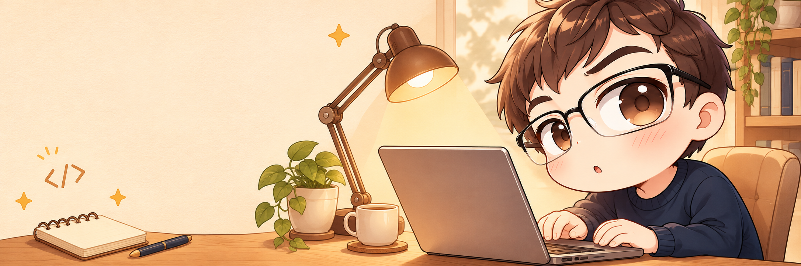
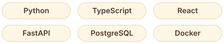

  

<h1 align="center">Hi, I'm Haoran 👋</h1>

Stay curious. Build little things that matter.

## About Me

I build practical AI tools and small applications, one curious idea at a time.

**AI applications · Developer tools · Local-first software**

## Selected Projects

### [Aegis-RAG](https://github.com/Odysseus-cyber/Aegis-RAG)

A local PDF Q&A app with streaming answers, source citations, and model quality monitoring.

### [VibeScope](https://github.com/Odysseus-cyber/VibeScope)

A data pipeline and dashboard for tracking public vibe-coded apps and generating evidence-backed AI reports.

### [Translate Agent](https://github.com/Odysseus-cyber/reflection-translation-agent)

A short-text translation workbench with draft, review, and revision stages, powered by Ollama or compatible model APIs.

## Toolbox

  

---

  

  
  Thanks for stopping by!

